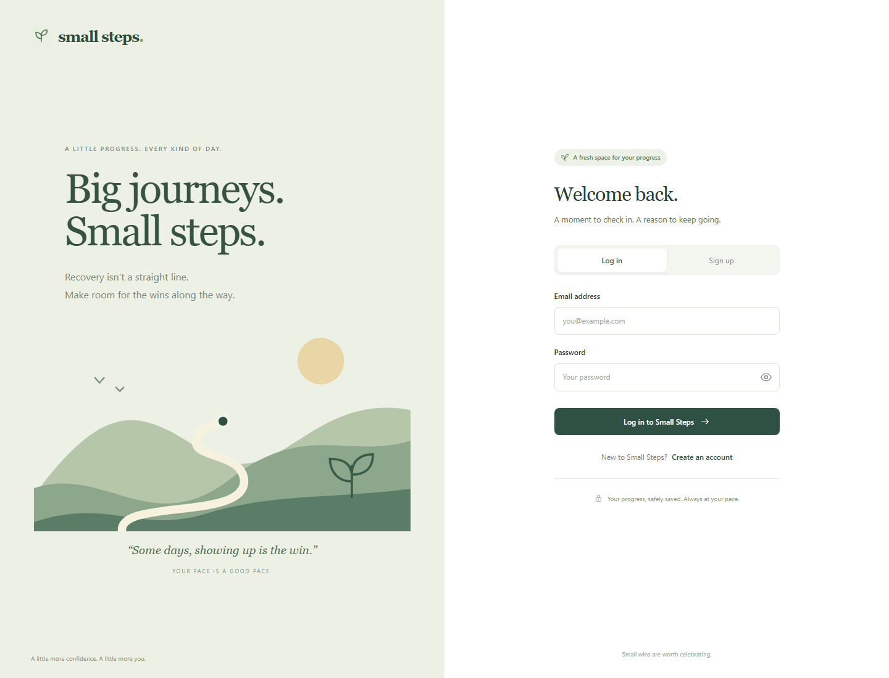
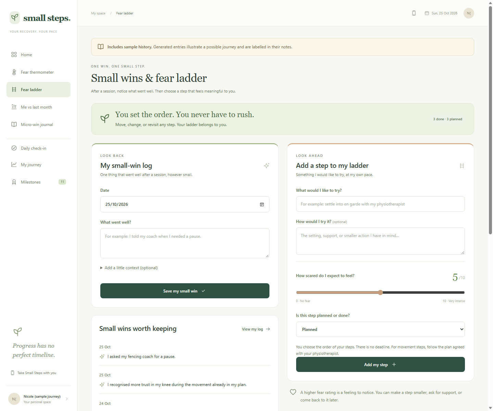
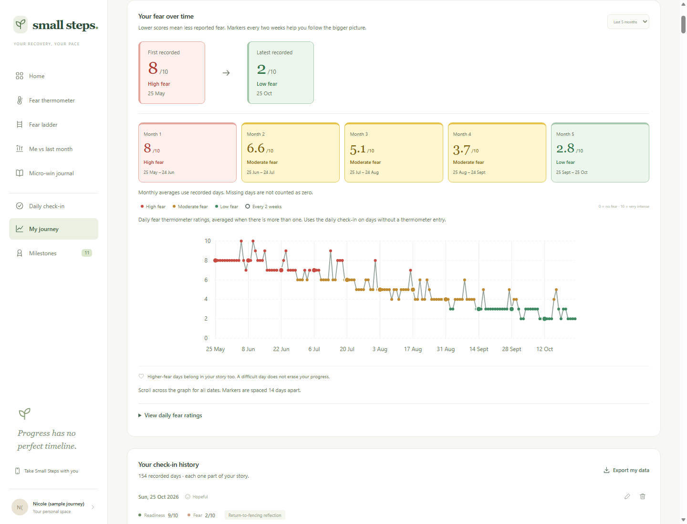

# Small Steps

> Small wins. Growing confidence. Your own pace.

A recovery journal that helps people notice progress, reflect on fear, and celebrate small wins. Our persona is **Nicole**, a fencer rebuilding confidence after an ACL injury.

**[Visit the website](https://small-steps-micro-wins.gladloach128.chatgpt.site)**

## Features

- **Daily check-ins and fear thermometer** — record readiness, fear, and what helped.
- **Small-win journal** — save something that went well after a session, however small.
- **Fear ladder** — choose a step, rate expected fear, and mark it Planned or Done. Set your own order without rushing.
- **Progress tracking** — follow changes over time with monthly summaries and a colour-coded fear graph.

## Website preview

### 1. Welcome

A calm space to sign in and begin a recovery journal.



### 2. Small wins and fear ladder

Record a small win on the left and plan the next manageable step on the right.



### 3. Progress over time

Nicole's five-month history shows gradual improvement with occasional harder days. Red means high fear, yellow means moderate fear, and green means low fear.



## Run locally

Requires **Node.js 24**. From the project folder:

```sh
npm start
```

Open **http://localhost:3000**. On Windows, you can also double-click `start.cmd` in the parent folder.

Built with JavaScript, HTML, CSS, Node.js, SQLite, and Cloudflare D1.

For setup, administration, testing, and hosting details, see the [development guide](docs/DEVELOPMENT.md).
